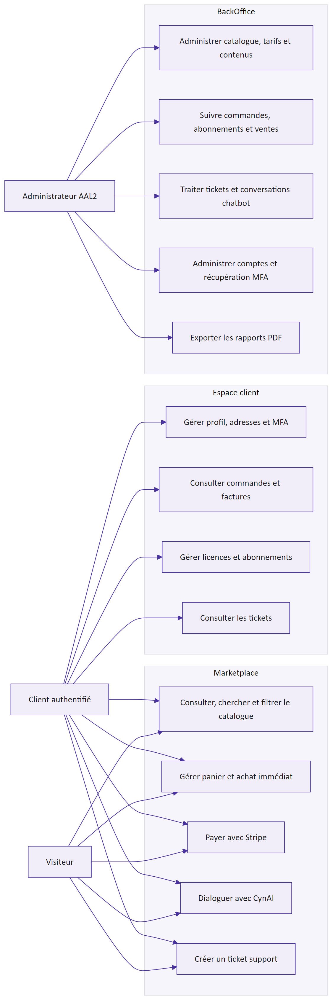

# Objet, portée et conventions

Cette spécification décrit le comportement réellement livré de la marketplace CYNA. Elle sert de base commune à la recette, au support et aux évolutions. Elle distingue les fonctions publiques, les fonctions nécessitant un compte, les fonctions BackOffice réservées à un administrateur avec MFA et les limites encore connues. Les noms techniques issus du code sont conservés lorsqu'ils lèvent une ambiguïté.

> Principe de vérité : en cas d'écart, le code de la branche `dev`, les migrations Supabase et les contrats Stripe priment. Ce document explicite cet état sans promettre une fonctionnalité non présente.

## Objectifs métier

- Présenter un catalogue bilingue de solutions SaaS de cybersécurité : SOC, EDR, XDR, pare-feu et services associés.
- Permettre la recherche, la comparaison par contenu et l'achat en paiement unique ou récurrent.
- Assurer le suivi des commandes, abonnements, factures et demandes d'assistance.
- Donner aux administrateurs un espace de gestion protégé par une authentification renforcée.
- Fournir CynAI, assistant conversationnel connecté au catalogue et au support, sans lui donner un accès direct non contrôlé à la base.

## Périmètre et exclusions

Le périmètre couvre le storefront Next.js, l'authentification Supabase, le paiement Stripe Checkout, le BackOffice, le support, le chatbot, la génération d'un rapport commerce PDF et les contenus bilingues. Sont hors périmètre de cette version : application mobile native, place de marché multi-vendeurs, facturation fiscale produite par CYNA, moteur de recommandation comportemental, replay de sessions, rate limiting applicatif du chatbot et migration de schéma Supabase.

# Acteurs et habilitations

| Acteur | Authentification | Capacités principales | Restrictions structurantes |
|---|---|---|---|
| Visiteur | Aucune | Naviguer, chercher, consulter le catalogue, gérer un panier local, payer en invité, utiliser CynAI, ouvrir un ticket | Pas d'historique de compte ; conversation identifiée par cookie invité |
| Client | Supabase Auth, session AAL1 | Capacités visiteur, profil, adresses, commandes, abonnements, factures, tickets | Accès limité aux données dont il est propriétaire par RLS et contrôles serveur |
| Administrateur | Supabase Auth et MFA TOTP, AAL2 | Catalogue, contenus, promotions, utilisateurs, commandes, support, rapports et historique chatbot | Compte actif, rôle `admin` et AAL2 exigés sur les fonctions sensibles |
| Stripe | Signature webhook | Notifier paiement, abonnement, échéancier et facture | Écriture par route serveur avec service role ; signature obligatoire |
| Gemini | Clé serveur | Générer la réponse CynAI et demander quatre outils déclarés | N'accède ni aux secrets ni directement à Supabase ; réponses d'outils minimisées |
| Opérateur | Accès Netlify, Sentry, Supabase et Stripe | Déployer, diagnostiquer, restaurer, gérer les secrets | Accès hors application, soumis aux comptes et MFA des plateformes |

# Parcours client

## Découverte et recherche du catalogue

Le storefront est localisé en français et anglais. Les catégories, produits, prix, caractéristiques et contenus éditoriaux affichés proviennent de Supabase. Le visiteur peut parcourir les catégories, consulter une fiche produit et lancer une recherche. La recherche rapide appelle `GET /api/search`, ignore une requête trop courte, applique la locale et renvoie au maximum six suggestions structurées. La page de résultats réutilise la même logique de recherche côté serveur.

Critères d'acceptation :

- un changement de locale conserve une navigation cohérente ; les traductions manquantes suivent les replis prévus par l'application ;
- une recherche inférieure à la longueur minimale renvoie une liste vide sans erreur ;
- une suggestion affiche un libellé, une catégorie, un prix exploitable et un lien vers le produit ;
- un produit indisponible n'est pas présenté comme achetable ;
- les données privées et champs d'administration ne sont jamais inclus dans le résultat public.

## Panier, promotions et préparation de commande

Le panier accepte plusieurs produits et quantités dans les limites du catalogue. Les calculs monétaires sont effectués en centimes ou à partir des montants métier contrôlés ; le client ne fournit jamais un montant de confiance à Stripe. Les promotions automatiques actives sont évaluées côté serveur selon leurs dates, leur cible produit ou catégorie et leurs contraintes. Une commande est créée avant la redirection vers Stripe afin de disposer d'un identifiant stable dans les métadonnées de session.

| Règle | Comportement attendu |
|---|---|
| Catalogue vide ou produit supprimé | L'élément n'est pas transformé en ligne de paiement valide |
| Prix | Issu du tarif actif en base, jamais du navigateur |
| Promotion | Appliquée uniquement si active, datée et liée à la cible ; cumul selon la logique livrée |
| Invité | L'e-mail et l'adresse sont capturés par Stripe puis réconciliés par webhook |
| Client connecté | `id_compte` est propagé dans la commande et les métadonnées Stripe |
| Facturation mixte | La session respecte le type de facturation du catalogue et les objets Stripe configurés |

## Checkout Stripe et finalisation asynchrone

Après validation du panier, une Server Action crée la session Checkout. Le navigateur est redirigé vers Stripe. Le retour visuel n'est pas la source de vérité du paiement : `checkout.session.completed` finalise la commande via le webhook signé et l'appel idempotent `finalize_paid_order`. Les mises à jour d'abonnement, échéancier et facture sont ensuite réconciliées par leurs événements dédiés.

## Compte, profil et adresses

L'inscription et la connexion reposent sur Supabase Auth. Le callback échange le code PKCE contre une session et n'accepte qu'une destination locale assainie. Le profil métier `utilisateur` complète `auth.users` : nom, prénom, rôle, activité et identifiant client Stripe. Un client peut maintenir ses adresses sans accéder à celles d'un autre compte. Lorsqu'un checkout connecté fournit une adresse complète, le webhook désactive l'ancienne adresse par défaut et crée ou réactive l'adresse correspondante.

## Commandes, abonnements et factures

Le compte présente les commandes appartenant au client, leurs lignes, l'état du paiement et les informations de facturation disponibles. Les abonnements sont synchronisés depuis Stripe ; l'application n'invente pas un état en l'absence de confirmation. Le portail client Stripe permet les opérations de gestion autorisées par la configuration `STRIPE_CUSTOMER_PORTAL_CONFIGURATION_ID`. Les factures Stripe sont indexées dans `facture` et leur PDF peut être copié dans le bucket privé `invoice-pdf`.

### États de commande

| État logique | Entrée typique | Sortie ou action permise | Remarque |
|---|---|---|---|
| Préparée / en attente | Création avant Checkout | Paiement ou abandon | Identifiant stable transmis à Stripe |
| Payée / finalisée | Webhook Checkout valide | Consultation, facture, abonnement éventuel | Finalisation atomique par RPC |
| Échouée ou incomplète | Checkout non abouti ou traitement en erreur | Nouveau paiement selon parcours | Une erreur webhook provoque un retry Stripe |
| Annulée | Décision métier ou abandon traité | Lecture historique | Pas de suppression silencieuse de l'historique |

### États d'abonnement

Les statuts bruts Stripe sont normalisés pour l'affichage et la santé opérationnelle. Les cas actifs, d'essai, en retard de paiement, incomplets, suspendus ou résiliés restent distingués. Une résiliation planifiée conserve sa date de fin. Les événements `customer.subscription.*` et `subscription_schedule.*` maintiennent la projection locale ; Stripe demeure la source de vérité financière.

# Support et chatbot CynAI

## Support par ticket

Un visiteur ou client peut ouvrir une demande via le formulaire de support. Un client connecté peut lier une commande qui lui appartient. Le ticket contient un sujet, une description, un statut, une priorité et un historique de messages. Le BackOffice permet aux administrateurs actifs d'instruire les demandes. Les contrôles d'accès empêchent un client de lire ou de lier la commande d'un autre compte.

| État ticket | Sens | Transition principale |
|---|---|---|
| Ouvert | Demande créée, non prise en charge | En cours ou fermé |
| En cours | Analyse ou réponse administrateur | En attente, résolu ou fermé selon l'usage |
| Résolu | Solution proposée ou action terminée | Réouverture possible selon le flux support |
| Fermé | Conversation terminée | Nouvelle demande si besoin distinct |

## Chatbot complet

CynAI utilise `gemini-3.1-flash-lite`. Le client envoie la locale, les tours visibles et, lorsqu'il la connaît, la propriété `conversationId` à `POST /api/chat`. La route émet un flux NDJSON : d'abord `conversation`, puis zéro ou plusieurs événements `text` et `card`, et enfin `done`; une défaillance après ouverture du flux émet `error`.

Le modèle ne requête pas librement le système. Il peut demander quatre fonctions déclarées :

| Outil | Entrées | Données retournées au modèle | Carte client |
|---|---|---|---|
| `search_products` | texte et catégorie facultatifs | nom, catégorie, prix, facturation, disponibilité ; 3 résultats max. | une carte `product` par résultat |
| `list_categories` | aucune | total et noms de 3 catégories max. | cartes `category` |
| `show_support_page` | aucune | confirmation minimale | carte `support` |
| `open_support_form` | aucune | formulaire affiché | carte `ticketForm`, e-mail et commandes si connecté |

La boucle est bornée à quatre rounds. Les parties du modèle sont réinjectées sans reconstruction afin de conserver les `thoughtSignature` requises par Gemini 3. À chaque appel d'outil, la route exécute le service interne, transmet au modèle une réponse compacte et diffuse au navigateur une carte structurée. Les cartes produit et catégorie sont révélées individuellement. Le texte final et des métadonnées sûres (types de cartes et noms d'outils, pas leurs contenus sensibles) sont persistés.

Un cookie HTTP-only `cyna_chat_guest` identifie l'invité. Seul son hash SHA-256 est stocké. Une conversation appartient soit à `auth.users`, soit au hash invité ; un identifiant arbitraire ne permet pas d'en reprendre la propriété. La durée cible de conservation est de 90 jours et une RPC de purge est disponible pour l'exploitation. Le formulaire intégré transforme l'escalade en création de ticket contrôlée. L'historique est consultable dans le BackOffice selon les garde-fous administrateur.

Limites acceptées dans cette version : absence de rate limiting dédié, validation de taille des messages perfectible, `conversationId` conservé seulement en mémoire côté client et donc perdu au rechargement, et tests de route API encore limités. Ces limites sont des risques suivis, pas des fonctions implicites.

# Parcours administrateur et MFA

Le BackOffice est protégé en profondeur. La session doit exister, le profil `utilisateur` doit être actif et porter le rôle `admin`, et le niveau d'assurance Supabase doit être `aal2` pour les opérations sensibles. L'administrateur enrôle un facteur TOTP, vérifie le challenge, puis accède aux écrans. Le flux de réinitialisation MFA fait l'objet d'un audit métier.

Les fonctions d'administration couvrent le catalogue et ses traductions, les caractéristiques techniques, le carrousel et les textes généraux, les promotions, les commandes, abonnements, tickets, conversations chatbot et rapports. Le rapport commerce PDF exige un admin actif en AAL2 et peut couvrir 7, 30, 90 jours, l'année en cours ou une période personnalisée valide.

# Règles transverses

## Internationalisation FR et EN

Les routes applicatives sont localisées. Les libellés d'interface proviennent de `next-intl`; les contenus métier traduisibles résident dans des tables dédiées. La locale invalide revient au français. Les symboles techniques, statuts Stripe et noms de champs restent en anglais lorsque leur traduction nuirait au diagnostic.

## Accessibilité et ergonomie

La cible est WCAG 2.1 niveau AA sur les parcours essentiels : navigation clavier, focus visible, structure de titres, étiquettes de champs, messages d'erreur explicites, contrastes suffisants et alternatives textuelles. Les composants modaux et menus doivent restituer le focus. Les cartes du chatbot ne doivent pas être le seul support de l'information critique. La recette inclut zoom 200 %, petit écran, clavier seul et lecteur d'écran sur connexion, recherche, checkout et ticket.

## Sécurité et confidentialité fonctionnelles

- Les secrets restent exclusivement côté serveur ou dans les plateformes de déploiement.
- Le rôle affiché dans le navigateur ne constitue jamais une autorisation ; les gardes serveur et RLS tranchent.
- Les webhooks Stripe sont vérifiés sur le corps brut et les écritures sont idempotentes.
- Sentry est configuré en erreurs seules, sans PII par défaut, sans replay, traces ni logs.
- Le chatbot ne stocke pas le cookie invité en clair et ne transmet à Gemini que les données nécessaires à la réponse.

<!-- landscape-start -->

# Matrice de recette

| ID | Précondition | Action | Résultat attendu | Niveau |
|---|---|---|---|---|
| REC-01 | Visiteur FR | Rechercher un mot valide | Six suggestions max., résultats localisés et cliquables | Critique |
| REC-02 | Visiteur | Ajouter un produit disponible puis modifier la quantité | Total cohérent, aucune valeur négative ou produit inexistant | Critique |
| REC-03 | Panier valide | Lancer Stripe Checkout test | Session construite avec prix serveur et identifiant de commande | Critique |
| REC-04 | Événement Stripe signé | Rejouer `checkout.session.completed` | Commande finalisée une seule fois, réponse 2xx | Critique |
| REC-05 | Signature Stripe invalide | Appeler le webhook | Réponse 400, aucune mutation, contenu sensible non envoyé à Sentry | Critique |
| REC-06 | Client AAL1 | Ouvrir ses commandes et factures | Uniquement ses données ; fichiers privés accessibles par mécanisme autorisé | Élevé |
| REC-07 | Client | Lier une commande dans un ticket | Seules ses commandes sont proposées et acceptées | Élevé |
| REC-08 | Admin sans MFA | Ouvrir le rapport commerce | Refus `AAL2_REQUIRED` | Critique |
| REC-09 | Admin actif AAL2 | Générer rapport 30 jours | PDF téléchargé, en-tête `private, no-store` | Élevé |
| REC-10 | Invité | Envoyer un message CynAI | Cookie HTTP-only, événement conversation, texte/cartes puis done | Élevé |
| REC-11 | Chatbot | Demander une recommandation | Outil catalogue appelé ; aucun produit inventé ; 3 cartes max. | Élevé |
| REC-12 | Chatbot | Demander l'ouverture d'un ticket | Carte formulaire ; préremplissage seulement si connecté | Élevé |
| REC-13 | Erreur Gemini | Poursuivre le stream | Événement error, tour partiel marqué, erreur technique capturée sans PII | Élevé |
| REC-14 | Locale EN | Parcourir puis ouvrir support | Navigation et contenus disponibles en anglais ou repli explicite | Moyen |
| REC-15 | Clavier seul, zoom 200 % | Exécuter connexion, recherche et support | Focus visible, ordre logique, aucun contenu essentiel coupé | Élevé |

<!-- landscape-end -->

# Limites et critères de sortie

La version est fonctionnellement recevable lorsque la CI `CI / quality` est verte, la preview Netlify passe les tests fumée, le webhook Stripe de test finalise une commande, un administrateur AAL2 produit un rapport, CynAI renvoie texte et cartes, et une erreur contrôlée apparaît dans Sentry sans données personnelles. La disponibilité réelle dépend des services Supabase, Stripe, Gemini, Netlify et Sentry.

Les limites prioritaires à traiter après ce socle sont : rate limiting et quotas chatbot, validation stricte des tailles, persistance client du `conversationId`, tests d'intégration des routes et webhooks, automatisation planifiée de la purge à 90 jours, tests E2E des parcours financiers, et preuve régulière de restauration Supabase.
