# Synthèse architecturale

CYNA est une application Next.js 16 App Router écrite en TypeScript, déployée sur Netlify avec son adaptateur OpenNext natif. Le navigateur consomme des pages React localisées et cinq routes HTTP publiques. Les Server Components et Server Actions concentrent les accès métier. Supabase fournit PostgreSQL, Auth, Row Level Security et Storage ; Stripe porte le paiement et les abonnements ; Gemini produit les réponses CynAI ; Sentry reçoit uniquement les erreurs applicatives filtrées. La couche de présentation repose sur Tailwind CSS 4, des primitives shadcn/Base UI et une approche mobile-first. Le présent DAT inclut enfin un MCD cardinalisé, quatre vues physiques et le dictionnaire des 28 tables du schéma métier.

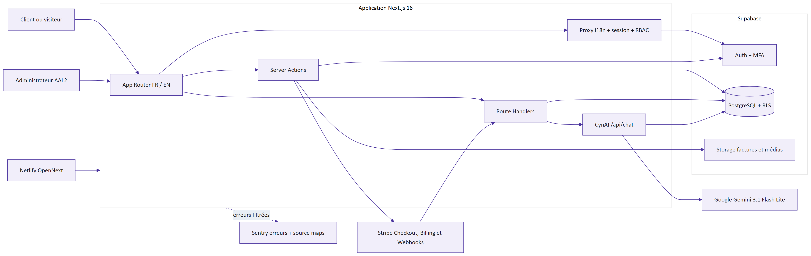

## Principes structurants

- Le serveur est l'autorité pour prix, rôles, propriété des données et transitions financières.
- `auth.users` est le système d'identité externe au schéma public ; `utilisateur` est son profil métier.
- Le navigateur n'obtient que les clés publiques Supabase et Sentry. Les clés service role, Stripe, Gemini et upload Sentry restent serveur.
- Les événements Stripe sont la source de vérité asynchrone du paiement ; les écritures sont réentrantes et idempotentes.
- Le chatbot utilise des outils applicatifs explicites et des cartes typées ; il ne dispose pas d'un SQL ou d'un accès Supabase générique.
- Les contenus traduisibles sont séparés de leurs entités stables afin de conserver une clé métier indépendante de la locale.

# Architecture runtime et déploiement

## Composants d'exécution

| Composant | Technologie | Responsabilité | Données sensibles |
|---|---|---|---|
| Frontend | React, Next.js App Router, next-intl | Navigation, rendu localisé, formulaires, cartes CynAI | Session via cookies, état du panier |
| Runtime Netlify | Node.js 24, OpenNext | SSR, routes HTTP, Server Actions, instrumentation | Secrets serveur et cookies de session |
| Supabase Auth | GoTrue managé | Session, PKCE, MFA TOTP, AAL | Identité et facteurs MFA |
| PostgreSQL Supabase | PostgreSQL, RLS, RPC | Catalogue, commerce, support, CMS, chat | Profils, commandes, tickets, conversations |
| Supabase Storage | Buckets privés/publics selon usage | Images et factures Stripe copiées | PDF de facture privé |
| Stripe | Checkout, Billing, Customer Portal, Webhooks | Paiement, abonnements, factures | Données de paiement gérées par Stripe |
| Gemini | Google GenAI | Génération CynAI et appels d'outils | Tours conversationnels nécessaires |
| Sentry | SDK Next.js | Erreurs client, serveur et edge filtrées | Aucun PII par défaut ; payload épuré |

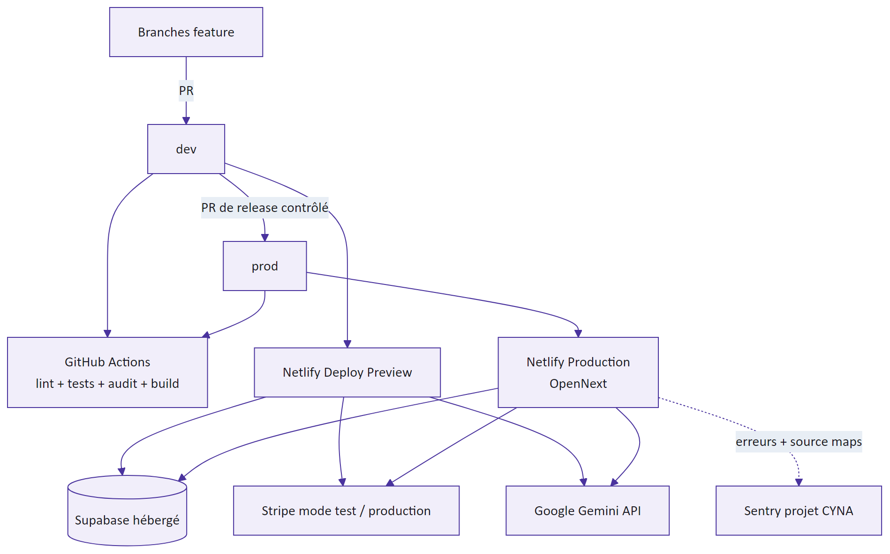

Le `netlify.toml` racine fixe `base = webapp-cyna`, `command = npm run build`, `publish = .next` et Node 24. Il ne contient ni secret ni plugin Next.js épinglé. Les variables Preview peuvent pointer vers des environnements de test ; les variables Stripe production, la clé Gemini et le DSN Sentry production sont limitées au contexte Production. Un PR construit une preview, mais ne déploie pas la production par GitHub Actions.

## Organisation applicative

L'arborescence `src/app/[locale]` porte les routes d'interface. `src/app/api` expose les cinq endpoints HTTP. `src/lib` regroupe les services par domaine : catalogue, panier, checkout, Stripe, commandes, abonnements, support, chat, Gemini, administration, authentification, i18n et observabilité. Les types Supabase générés sont dans `src/types/database.types.ts`. Cette séparation évite de dupliquer les règles de recherche ou de sécurité entre l'interface et le chatbot.

| Couche | Convention | Exemple |
|---|---|---|
| Présentation | Server et Client Components localisés | Pages catalogue, compte et BackOffice |
| Entrée HTTP | `route.ts`, validation et réponse explicites | `/api/chat`, `/api/webhooks/stripe` |
| Orchestration | Server Actions ou services serveur | Création checkout, gestion portail client |
| Domaine | Fonctions pures ou services spécialisés | statuts, promotions, rapports, accès support |
| Persistance | Clients Supabase public, session ou service role | RLS pour l'utilisateur ; service role pour webhook/chat |
| Intégration | Wrappers Stripe, Gemini et Sentry | vérification signature, outils, capture filtrée |

# Cycle d'exécution Next.js

## Routage, localisation et session

Le fichier `src/proxy.ts` constitue le point d'entrée commun des pages, à l'exception des routes API, des ressources Next.js et des fichiers statiques. Il compose le middleware `next-intl` avec le rafraîchissement de session Supabase sur le même objet `NextResponse`, afin de ne pas perdre une réécriture de locale lorsqu'un cookie d'authentification est renouvelé. La locale est déduite du préfixe `/fr` ou `/en`; les routes publiques, d'authentification, de compte et d'administration restent ainsi cohérentes.

Pour un utilisateur connecté, le proxy relit le profil `utilisateur` et le niveau d'assurance MFA. Un profil inactif est déconnecté localement. Lorsqu'un facteur est enrôlé mais que la session courante reste AAL1, l'utilisateur est redirigé vers `mfa-verify` avec un paramètre `next` interne. Sur `/admin`, les trois conditions session présente, profil admin actif et AAL2 sont cumulatives. Ces contrôles de navigation améliorent le parcours, mais les opérations sensibles répètent leur autorisation côté serveur.

| Étape | Entrée | Traitement | Sortie ou invariant |
|---|---|---|---|
| Résolution de locale | URL entrante | `next-intl` réécrit ou redirige | préfixe FR/EN canonique |
| Session | cookies Supabase | lecture utilisateur et renouvellement éventuel | cookies reportés sur la réponse i18n |
| Profil | `auth.users.id` | lecture `utilisateur.role` et `is_actif` | utilisateur inactif exclu |
| Assurance | facteurs Supabase MFA | comparaison `currentLevel` / `nextLevel` | challenge TOTP avant action sensible |
| Autorisation | route et contexte | contrôle admin ou propriétaire dans le service | refus avant accès privilégié |

## Server Components, Server Actions et routes HTTP

Les Server Components effectuent les lectures nécessaires au premier rendu sans exposer les clients privilégiés au bundle navigateur. Les Client Components restent réservés à l'état interactif, aux formulaires et au streaming CynAI. Les mutations déclenchées depuis l'interface passent majoritairement par des Server Actions : leur sérialisation par Next.js n'est pas une autorisation, chaque action doit relire la session, les identifiants et les valeurs métier.

Les cinq routes HTTP sont employées lorsqu'un contrat protocolaire est nécessaire : recherche JSON, callback PKCE, rapport PDF, flux NDJSON et webhook Stripe. Elles produisent des statuts et types MIME explicites. Les exceptions non prévues remontent à `onRequestError`; les erreurs déjà interceptées dans les domaines critiques sont transmises par `captureOperationalException` avec `area` et `stage`, puis une réponse générique est rendue au client.

| Mode d'entrée | Usage | Autorité de données | Gestion d'erreur |
|---|---|---|---|
| Server Component | lecture d'une page et de son contexte | session Supabase et RLS | page d'erreur Next.js ou état vide explicite |
| Server Action | mutation issue d'un formulaire | revalidation serveur des entrées et du propriétaire | résultat métier contrôlé, exception filtrée si inattendue |
| Route Handler | contrat HTTP/stream/webhook | garde dédiée, signature ou session | statut HTTP, corps minimal, capture opérationnelle |
| Proxy | locale, session et orientation d'accès | Auth, profil et assurance MFA | redirection locale sûre |

## Composition de configuration et build

`next.config.ts` compose d'abord le plugin `next-intl`, puis `withSentryConfig`. La racine Turbopack est fixée sur `webapp-cyna` pour que la résolution des paquets, du CSS et des manifestes ne dépende pas du dépôt parent. Sentry reçoit organisation, projet et jeton uniquement au build de production ; sans jeton, le build reste silencieux et fonctionnel, mais aucune source map n'est téléversée. Cette composition est couverte indirectement par le build CI avec des valeurs factices non secrètes.

Le runtime n'embarque pas de serveur long-lived géré par l'équipe : Netlify transforme le build Next.js en fonctions et ressources OpenNext. Les effets persistants doivent donc être écrits dans Supabase, Stripe ou Storage, jamais conservés uniquement dans la mémoire d'une instance. Le `conversationId` gardé seulement dans l'état React illustre précisément la limite restante côté client.

<!-- page-break -->

# Architecture front-end et design system

La couche front-end n'est pas une SPA autonome posée devant une API générique. Elle est intégrée à l'App Router : les Server Components produisent le premier rendu à partir des données autorisées, tandis que les Client Components sont introduits seulement lorsqu'un état navigateur, une interaction continue ou une API Web est nécessaire. Ce découpage réduit le JavaScript envoyé pour les pages de lecture et maintient la session, la locale et les règles métier du côté serveur. Les frontières clientes les plus visibles sont les formulaires interactifs, le panier éditable, les filtres de recherche, les galeries, les menus, la navigation BackOffice et le streaming CynAI.

L'interface suit quatre niveaux de composition. Les layouts définissent les structures durables : en-tête public, pied de page, navigation de compte, topbar et sidebar d'administration. Les primitives de `src/components/ui` normalisent les contrôles, conteneurs, overlays et états de focus. Les composants métier assemblent ces primitives autour d'un contrat de domaine, par exemple `ProductPricingCard`, `CartItemCard`, `GuestCheckoutDialog` ou les cartes CynAI. Enfin, les pages orchestrent les lectures serveur et passent des données déjà filtrées aux composants. Une primitive ne doit pas connaître Supabase ou Stripe ; inversement, une page ne devrait pas réimplémenter le comportement clavier d'un dialogue ou d'un bouton.

| Niveau UI | Responsabilité | Exemples réels | Invariant recherché |
|---|---|---|---|
| Layout | structure persistante, navigation et largeur de lecture | `PublicHeader`, `PublicFooter`, `AdminSidebar`, `UserDashboardNav` | ne pas dupliquer les repères de navigation entre pages |
| Primitive | interaction générique et états accessibles | `Button`, `Input`, `Card`, `Sheet`, `Table`, `Tooltip` | API visuelle stable, focus et états désactivés cohérents |
| Composant métier | présentation d'un concept et orchestration locale | produit, tarif, panier, abonnement, ticket, carte CynAI | données typées et mutation déléguée au service adapté |
| Page App Router | lecture serveur, garde, locale et composition | catalogue, détail produit, compte, BackOffice | aucune clé privilégiée ni autorité tarifaire dans le client |

Les états locaux sont volontairement bornés. Le nombre de licences est tamponné dans le navigateur puis normalisé avant la Server Action ; une transition React matérialise l'attente sans rendre le client autoritaire. Les filtres de recherche écrivent leur état dans la query string avec un debounce : l'URL reste partageable et le serveur recalcule le résultat. Le panier est relu après mutation. CynAI fait exception par sa nature streamée : le hook client agrège le NDJSON et les cartes, mais la conversation canonique est persistée côté serveur. Cette architecture évite un store global unique dont la cohérence serait difficile à maintenir entre rendu serveur, navigation localisée et mutations.

## Système visuel, tokens et composants

Le socle est Tailwind CSS 4, importé depuis `globals.css`, complété par `tw-animate-css` et la feuille shadcn. `components.json` déclare le style `base-vega`, le support des React Server Components, les variables CSS et Lucide comme bibliothèque d'icônes. Les primitives interactives s'appuient en majorité sur Base UI, qui fournit la mécanique accessible sans imposer le rendu. `class-variance-authority` décrit les variantes de composants ; `cn()` compose `clsx` et `tailwind-merge` afin qu'une surcharge métier remplace proprement une classe de base au lieu de produire deux règles contradictoires.

Le design system est piloté par des tokens sémantiques plutôt que par une couleur liée directement à chaque composant. `@theme inline` expose à Tailwind `background`, `foreground`, `card`, `popover`, `primary`, `secondary`, `muted`, `accent`, `destructive`, `border`, `input`, `ring`, les couleurs de graphiques et celles de sidebar. La palette racine utilise OKLCH, espace qui facilite des variations de luminosité plus prévisibles. Les composants peuvent ainsi demander `bg-primary` ou `text-muted-foreground` sans connaître la valeur concrète. Une famille de rayons est calculée depuis `--radius: 0.625rem`, du petit contrôle jusqu'aux grandes cartes.

| Famille de tokens | Implémentation | Usage architectural | Écart actuel |
|---|---|---|---|
| Couleurs sémantiques | variables OKLCH dans `:root` et `.dark` | surfaces, texte, focus, erreur, graphiques | le site public emploie encore beaucoup de classes `slate-*` et `purple-*` directes |
| Marque BackOffice | surcharge `.admin-theme` de `primary`, `accent`, `ring` et `sidebar-*` | identité violette cohérente jusque dans les portails | thème clair uniquement, sans contrat public équivalent entièrement tokenisé |
| Typographie | Inter pour `--font-sans`, Geist Mono pour le code | lecture UI, chiffres, contrats techniques | `font-heading` réutilise la sans ; aucune échelle typographique centralisée nommée |
| Formes | rayon racine et échelle `sm` à `4xl` | boutons, champs, cartes, sheets et notifications | quelques composants métier fixent directement `rounded-*` |
| Élévation | `shadow-xs`, `shadow-sm`, `shadow-lg` et ombres de marque | hiérarchie des cartes, overlays et feedback | les ombres CynAI/notifications sont spécifiques, non exposées comme tokens |
| Mouvement | transitions utilitaires et keyframes CYNA | changement d'état, navigation de contexte, feedback | couverture `prefers-reduced-motion` partielle hors transition de site |

Deux portées de thème coexistent. Le public conserve un fond blanc, une gamme ardoise pour le contenu et le violet CYNA pour les actions et repères. Le BackOffice applique `.admin-theme` au provider et au `body` via `AdminThemeBody`, détail important car les dialogues et sheets sont rendus dans des portails hors du sous-arbre du layout. Ils héritent ainsi des mêmes variables que la page d'administration. Une palette `.dark` est définie dans la feuille globale, mais aucun sélecteur de thème sombre n'est livré : elle constitue une capacité technique dormante, pas une fonctionnalité à annoncer. Le BackOffice est explicitement conçu en thème clair.

La police principale est Inter, chargée par `next/font` et exposée sous `--font-sans`. Geist Sans et Geist Mono sont également déclarées ; la monospace sert aux usages techniques, tandis que les titres réutilisent actuellement la sans. L'option dyslexie remplace la famille par OpenDyslexic. Cette dernière est importée depuis un CDN CSS externe : sa disponibilité et sa politique de sécurité doivent donc être considérées séparément des polices empaquetées par Next.js. L'échelle courante va des métadonnées à `text-xs` jusqu'aux titres de page à `text-3xl`; le poids, la couleur et l'espacement portent la hiérarchie davantage qu'une multiplication de familles.

Les primitives les plus structurantes possèdent un contrat explicite. `Button` propose les variantes `default`, `brand`, `outline`, `secondary`, `ghost`, `destructive` et `link`, ainsi que des tailles texte ou icône. Tous les boutons partagent focus visible, état actif, désactivation, gestion `aria-invalid` et neutralisation des événements SVG. `Input` conserve un texte de base sur petit écran, puis passe à `text-sm` à partir de `md`; le corps à 16 px sur mobile évite notamment le zoom automatique de certains navigateurs lors du focus. `Card` expose des slots d'en-tête, contenu, action et pied, avec une variante compacte. `Sheet` fournit les tiroirs et sidebars mobiles. `Table` place la table dans un conteneur `overflow-x-auto`, contrat réutilisé par le BackOffice.

Les attributs `data-slot` donnent un vocabulaire structurel aux primitives sans imposer un composant propriétaire lourd. Ils servent aux sélecteurs de thème et aux corrections responsive du layout admin. Les composants de domaine peuvent ajouter leurs classes via `cn()` tout en conservant les états fondamentaux. La règle d'architecture est de préférer une variante de primitive lorsqu'un motif se répète ; une classe locale reste acceptable pour un besoin métier unique. En pratique, le code est encore en transition : les nouvelles primitives sont cohérentes, mais plusieurs écrans historiques composent directement boutons, cartes et tableaux avec des utilitaires Tailwind ou des modules SCSS.

Le feedback utilisateur suit plusieurs canaux complémentaires. Les actions longues utilisent `useTransition`, `aria-busy`, une opacité contrôlée et un indicateur de chargement. Le provider de notifications limite l'empilement à trois éléments, expose les statuts succès, information et erreur, annonce le message par `aria-live` et autorise une fermeture explicite. Les erreurs de formulaire associent texte, bordure destructive et `aria-invalid`. Les états vides restent rendus dans la structure de la page au lieu d'être confondus avec un chargement. Les modales limitent leur hauteur à `calc(100dvh - 2rem)` et activent le scroll interne, ce qui protège l'accès aux actions sur un écran court ou avec clavier virtuel.

## Approche mobile-first et comportements responsive

Les classes sans préfixe décrivent le téléphone ; les variantes `sm`, `md`, `lg`, `xl` et `2xl` enrichissent progressivement la mise en page lorsque la largeur augmente. Le dépôt ne maintient donc pas deux arbres React « mobile » et « desktop » pour une même page, sauf lorsqu'une représentation de données réellement différente améliore l'usage. Dans l'état documenté, 79 fichiers TypeScript/TSX utilisent des variantes responsive : `sm` domine nettement avec 275 occurrences, devant `lg` 59, `md` 27, `xl` 22 et `2xl` 1. Ces nombres décrivent un instant du code, pas un objectif de couverture.

Les seuils suivent les valeurs Tailwind usuelles : `sm` à 640 px, `md` à 768 px, `lg` à 1024 px, `xl` à 1280 px et `2xl` à 1536 px. Le seul breakpoint centralisé en JavaScript, `MOBILE_BREAKPOINT = 768`, est aligné sur `md`. Il sert à la sidebar : sous 768 px elle devient un `Sheet` de 18 rem, au-dessus elle occupe 16 rem et peut se replier. Les autres décisions restent en CSS, ce qui évite de dériver le rendu initial depuis le user-agent et limite les divergences d'hydratation.

| Zone | Téléphone, règle de base | À partir du breakpoint | Justification |
|---|---|---|---|
| En-tête public | logo compact, recherche par bouton, panier et menu 44 px | recherche et catégories visibles à `md`; compte/connexion à `lg` | conserver les actions critiques sans comprimer le champ de recherche |
| Grilles catalogue | une colonne | deux à `sm`, trois à `lg`, parfois quatre à `xl` | carte lisible avant maximisation de la densité |
| Détail produit | galerie, informations puis tarification en flux vertical | grille à `lg`, panneau tarifaire de 360 px sticky | achat visible sur grand écran, ordre naturel au clavier sur mobile |
| Espace client | navigation en grille 2 colonnes | 4 colonnes à `sm`, sidebar 256 px à `lg` | cibles tactiles avant navigation verticale persistante |
| BackOffice | sidebar off-canvas, topbar compacte, contenu avec marge réduite | sidebar fixe à `md`, padding croissant à 768 et 1280 px | préserver l'espace de travail et la profondeur de navigation |
| Tableaux | scroll horizontal contenu ou cartes dédiées | table complète à `md` pour commandes/factures client | éviter une table illisible sans perdre les champs utiles |
| CynAI | panneau presque pleine largeur, hauteur max 70 vh, ancré au safe area | largeur fixe de 384 px à `sm` | rester utilisable avec clavier virtuel et ne pas masquer toute la page |
| Dialogues | largeur `calc(100% - 2rem)`, hauteur dynamique et scroll interne | largeur bornée par `max-w-*`, padding accru à `sm` | aucune action hors viewport, même en orientation paysage |

L'en-tête fixe mesure 72 px et la page réserve exactement cet espace afin d'éviter un recouvrement du contenu. Sous `md`, la recherche principale est remplacée par un bouton de 44 px ouvrant une ligne pleine largeur sous l'en-tête ; `aria-expanded`, `aria-controls` et Échap exposent son état. Le tiroir latéral regroupe session, inscription, catégories, informations, langue et préférences d'accessibilité. Le pied de page visuel est masqué sur mobile, mais ses destinations restent accessibles dans ce menu. La page publique ajoute un padding inférieur mobile afin que les éléments flottants et les commandes basses ne recouvrent pas le dernier contenu.

Les pages catalogue partent d'une colonne. Les catégories et produits passent à deux cartes à `sm`, trois à `lg`, et les listes les plus larges à quatre à `xl`. Les cartes utilisent un ratio d'image 16/9 ou une hauteur minimale stable, ce qui limite les déplacements de mise en page pendant le chargement. Le détail produit conserve l'ordre galerie, description, caractéristiques et prix dans le DOM. À `lg`, il devient une grille dont la colonne d'achat est sticky sous l'en-tête. Cette transformation purement CSS préserve l'ordre de lecture et évite de dupliquer le formulaire de tarification.

L'espace client illustre une adaptation plus sémantique. Sa navigation est une grille de grandes destinations tactiles sur mobile, puis une sidebar sticky à `lg`. Les adresses et abonnements passent progressivement à plusieurs colonnes. Les commandes et factures choisissent une représentation en cartes sous `md`, puis une table au-dessus : cette duplication visuelle est justifiée par la différence de tâche, car faire défiler six colonnes sur un téléphone rend la comparaison et l'action plus difficiles. Les onglets d'achats restent horizontalement scrollables plutôt que de réduire le texte sous un seuil lisible.

Le BackOffice conserve les tables, car l'opérateur doit comparer de nombreuses colonnes. La primitive `Table` fournit le scroll horizontal ; le layout admin lui ajoute inertie tactile, containment de l'overscroll et gouttière de scrollbar stable. Sous 640 px, le conteneur devient visuellement bord à bord tout en gardant un padding interne. Les dashboards utilisent des cartes KPI en une colonne puis 2/4/6 colonnes, et les graphiques Recharts sont placés dans `ResponsiveContainer`. Les tables de classement imposent une largeur minimale et préfèrent le scroll à l'écrasement des libellés.

Les unités de viewport modernes sont utilisées là où la barre d'adresse mobile ou le clavier change la hauteur réellement disponible : `svh` pour les structures plein écran stables, `dvh` pour la hauteur maximale des overlays. CynAI ancre son lanceur à `env(safe-area-inset-bottom)` afin de respecter les zones réservées des appareils. Son panneau occupe `100vw - 1.5rem` sur petit écran, reste borné à 70 % de la hauteur et se place au-dessus du lanceur. Les dialogues centrés préservent deux marges de 1 rem. Ces règles empêchent les principaux contrôles de sortir du viewport sans supposer un modèle d'appareil précis.

La stratégie ne garantit pas encore chaque cas extrême. Les libellés allemands ou RTL ne sont pas dans le périmètre ; `components.json` déclare d'ailleurs `rtl: false`. Les vues très étroites, le zoom à 200 %, les claviers virtuels et les écrans paysage nécessitent des tests de navigateur dédiés. La cohérence du breakpoint 768 px est actuellement implicite entre Tailwind et `useIsMobile`; une personnalisation future des breakpoints devra modifier et tester ces deux sources ensemble.

## Accessibilité, interactions et performance perçue

Le layout racine renseigne `lang` avec la locale active et fournit les messages FR/EN via `next-intl`. Les icônes purement décoratives sont généralement `aria-hidden`; les boutons icône reçoivent un nom accessible. Les menus, champs, listes et tableaux utilisent des éléments natifs autant que possible. Les dialogues portent un titre accessible, les switches du menu d'accessibilité exposent `role="switch"` et `aria-checked`, et les notifications distinguent `status` de `alert`. Les formulaires conservent des labels ou des `aria-label` explicites, tandis que `focus-visible` évite de supprimer l'indicateur clavier.

Les cibles mobiles majeures (menu, recherche, panier, fermeture, envoi CynAI et navigation) utilisent fréquemment 44 px (`size-11` ou `min-h-11`). Ce seuil n'est cependant pas imposé à toutes les primitives : le bouton par défaut mesure 36 px et les variantes compactes sont destinées aux contextes denses. Le contrat est donc contextuel : une commande isolée et essentielle sur écran tactile doit être agrandie ; une action secondaire dans une table opérateur peut rester compacte si elle conserve un nom, un focus et un espacement suffisants.

Le menu d'accessibilité persiste quatre préférences locales : augmentation de la racine à 120 %, police OpenDyslexic, mise en évidence des liens et filtre de perception des couleurs. Les classes sont réappliquées après navigation client et synchronisées entre onglets. Ces aides ne remplacent pas l'accessibilité intrinsèque : le filtre daltonisme ne prouve pas les contrastes, une police dédiée ne corrige pas la structure, et l'agrandissement doit être vérifié sans perte de contenu. La navigation clavier, les titres, l'ordre DOM, les libellés et la communication des erreurs restent prioritaires.

Les overlays ferment sur Échap lorsqu'ils implémentent une interaction personnalisée ; le chat restitue le focus au lanceur après fermeture. Le moteur Base UI porte le piégeage de focus et les états de ses dialogues/sheets. La transition entre marketplace et BackOffice annonce son état par `aria-live="assertive"`, bloque temporairement le scroll et prévoit un timeout de secours. Elle interroge `prefers-reduced-motion` pour réduire ses délais, et les keyframes associées passent à 1 ms. Les animations du chat, des notifications et de certaines cartes ne sont pas toutes couvertes par une règle équivalente : c'est une dette d'accessibilité à traiter, non une conformité supposée.

La performance perçue découle d'abord du rendu serveur. Les pages de catalogue, les layouts et plusieurs cartes restent des Server Components ; seuls les widgets interactifs hydratent. Les logos utilisent `next/image` et les zones média réservent leur ratio. Les images catalogue sont en revanche souvent appliquées comme `background-image` pour le cadrage `cover`; elles ne bénéficient alors pas automatiquement du redimensionnement, des `sizes` et du lazy loading de `next/image`. Une politique de loader Supabase ou de variantes d'images serait préférable si le volume média augmente.

Les mutations affichent immédiatement un état pending, empêchent les doubles soumissions et laissent le serveur réémettre les totaux. Les filtres prix attendent 400 ms avant de mettre à jour l'URL. Les notifications expirent sans bloquer l'interface. Les transitions visuelles restent courtes et l'élévation remplace les overlays inutiles : CynAI flotte sans rendre le reste de la page inerte. À l'inverse, Checkout et les confirmations destructives utilisent un vrai dialogue modal car l'utilisateur doit terminer ou annuler une décision avant de continuer.

Le design system est donc opérationnel mais pas encore complètement gouverné. Il n'existe ni catalogue Storybook, ni tests de régression visuelle, ni paquet de tokens partagé, ni matrice E2E automatisée par viewport. Les primitives récentes utilisent des tokens sémantiques, alors que le public historique emploie encore directement `slate`, `purple` et des ombres particulières ; des modules SCSS subsistent dans les formulaires et le layout admin. Cette hybridation est acceptable à court terme, mais elle augmente le risque de divergence lors d'un changement de marque.

| Priorité d'évolution UI | Action technique | Critère de sortie |
|---|---|---|
| Gouvernance | documenter les tokens publics et convertir les motifs répétés en variantes de primitives | une couleur ou élévation de marque change à un endroit contrôlé |
| Responsive | ajouter des parcours Playwright à 360, 768, 1024 et 1440 px, avec zoom et paysage | aucune action critique coupée, aucun scroll horizontal de page |
| Accessibilité | automatiser axe, tester clavier/lecteur d'écran et généraliser `prefers-reduced-motion` | zéro violation critique et scénarios clavier documentés |
| Médias | remplacer les backgrounds produits par un composant image optimisé lorsque possible | tailles adaptées, lazy loading et ratio conservé |
| Documentation | maintenir un inventaire des primitives, variantes, états et usages interdits | une nouvelle page réutilise le système sans style parallèle |
| Internationalisation | éliminer les libellés techniques anglais résiduels et préparer la direction de texte | aucun nom accessible codé en dur ; décision RTL explicite |

Les limites ci-dessus doivent être distinguées d'un défaut responsive général : les parcours principaux disposent déjà d'une adaptation mobile concrète. La dette porte surtout sur l'industrialisation de sa preuve, l'unification des tokens et les cas d'accessibilité avancés. Une future refonte ne devrait pas commencer par remplacer les primitives existantes, mais par figer leurs contrats, mesurer les écarts puis migrer progressivement les composants historiques.

# Identité, sécurité et autorisations

Supabase Auth dépose la session dans des cookies gérés par le client serveur. Le callback PKCE échange un `code` et assainit `next` pour empêcher une redirection ouverte. Le profil `utilisateur.id_compte` référence l'identité Auth. Les gardes serveur vérifient successivement session, rôle, activité et, pour le BackOffice sensible, AAL2. L'interface peut masquer une action, mais seul le serveur autorise.

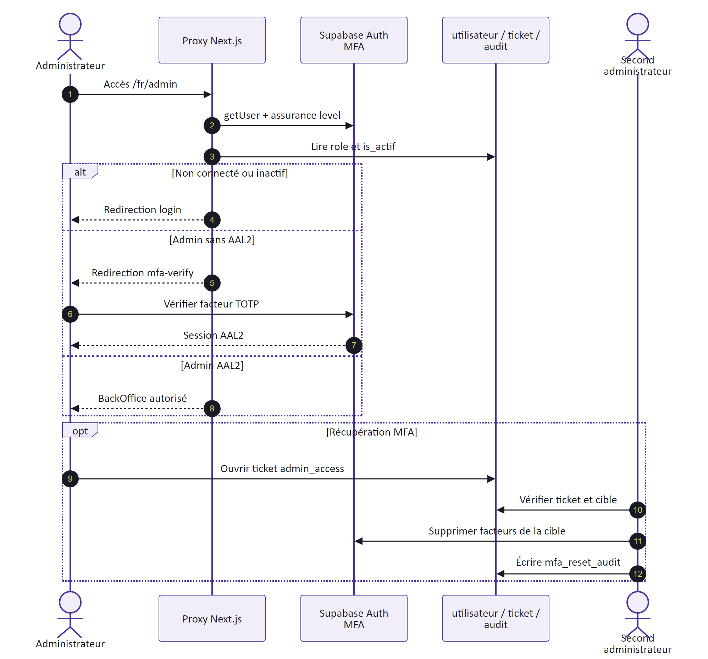

La RLS réduit les lignes visibles et modifiables par un client authentifié. Les routes publiques lisent uniquement les projections de catalogue nécessaires. Le client service role est réservé aux traitements dont l'identité ne peut pas porter l'écriture : webhook Stripe, persistance chatbot contrôlée et tâches d'exploitation. Toute entrée dans ce périmètre doit d'abord vérifier sa preuve de confiance, par signature Stripe ou propriété de conversation.

# Architecture des données et de la persistance

## Clients Supabase et frontières de privilège

CYNA utilise plusieurs constructions de client Supabase afin que le moyen d'authentification reflète la confiance disponible. `createServerClient` s'appuie sur la clé anonyme et les cookies de la requête : les politiques RLS voient alors l'identité du client. Les lectures publiques utilisent également une clé publique avec une projection limitée. `createAdminClient` et les clients service role contournent la RLS ; ils sont confinés aux modules serveur et ne sont appelés qu'après une garde métier ou une preuve externe.

| Client logique | Preuve disponible | Capacités | Emplois représentatifs |
|---|---|---|---|
| Public anonyme | aucune identité | lecture des données publiées par politique | catalogue, catégories, recherche |
| Serveur de session | cookies Supabase valides | droits de l'utilisateur sous RLS | profil, adresses, commandes, factures, tickets |
| Admin après garde | session, profil admin actif, AAL2 | agrégations et mutations BackOffice nécessaires | rapport commerce, administration sensible |
| Service webhook | signature Stripe vérifiée sur corps brut | écriture financière réentrante | commande, abonnement, facture |
| Service chatbot | propriété compte ou hash invité vérifiée | persistance conversationnelle ciblée | conversations et messages CynAI |

La présence d'un identifiant dans une requête ne constitue jamais la preuve de propriété. Les services relient l'identité Auth au profil métier, filtrent sur `id_compte` lorsque la RLS ne suffit pas à exprimer le cas, et n'acceptent une commande dans un ticket ou le chatbot qu'après l'avoir retrouvée dans le périmètre autorisé.

## Cohérence, idempotence et transactions distribuées

Une transaction PostgreSQL protège les opérations regroupées dans une fonction RPC, notamment la finalisation de commande. Elle ne peut toutefois pas englober simultanément Stripe, Storage et PostgreSQL. L'architecture assume donc une cohérence asynchrone : identifiant de commande propagé à Stripe, identifiants externes uniques, upserts, fonctions réentrantes et possibilité de rejouer un webhook.

| Risque de cohérence | Mécanisme | Vérification d'exploitation |
|---|---|---|
| Retour navigateur sans webhook | statut commande non finalisé | surveiller événements et commandes en attente |
| Webhook livré plusieurs fois | RPC réentrante et upsert par identifiant Stripe | rejouer en staging et vérifier absence de doublon |
| PDF indisponible temporairement | métadonnées de facture conservées, téléchargement rejouable | runbook facture absente |
| Échec après mutation Stripe | nouvelle synchronisation depuis Stripe | réconciliation mensuelle |
| Déploiement avec migration incompatible | migration additive et code compatible | ordre migration, CI, preview puis smoke test |

## Storage, migrations et types

Les buckets `product-images`, `category-images` et `carousel-images` servent des médias publics. `invoice-pdf` reste privé : le service serveur y écrit la copie d'une facture Stripe et l'espace client demande une URL signée après contrôle de propriété. Rendre ce bucket public pour contourner un incident est explicitement interdit.

Le schéma initial et les migrations additives sont versionnés sous `supabase/migrations`. Après toute évolution, `database.types.ts` doit être régénéré puis comparé ; ce fichier est un contrat compilable entre SQL et TypeScript, pas une source à éditer manuellement. Le présent chantier ne change ni schéma ni contrat API. Une migration future doit préciser nullabilité, politiques RLS, backfill, compatibilité ascendante et stratégie de restauration.

# Catalogue, panier et internationalisation

Les entités de catalogue conservent leurs attributs stables séparément des tables `*_traduction`. Une locale demandée sélectionne d'abord sa traduction, puis applique le repli métier documenté. La recherche publique et CynAI partagent le même service de catalogue afin d'éviter des résultats, prix ou disponibilités divergents. Fuse.js apporte la tolérance textuelle ; la route `/api/search` borne la réponse à six suggestions et les outils Gemini à trois produits.

Le panier est matérialisé par le cookie `cyna_cart`, valable trente jours. Il contient des identifiants et quantités d'interface, pas l'autorité tarifaire. Au checkout, le serveur relit produit, tarif, mode de facturation, disponibilité, limites de sièges et promotions. Le nombre d'utilisateurs est normalisé dans la plage métier 1–50. Une valeur cliente supprimée, obsolète ou négative ne peut donc pas devenir une ligne de paiement valide.

| Sous-domaine | Donnée stable | Donnée localisée ou volatile | Règle d'autorité |
|---|---|---|---|
| Produit | identifiant, catégorie, disponibilité | nom, description, visuels | base côté serveur |
| Tarif | identifiant, type de facturation, référence Stripe | libellé localisé | prix relu avant Checkout |
| Promotion | type, dates, cible, activité | message d'affichage | éligibilité recalculée au serveur |
| Panier | identifiants et nombre d'utilisateurs | cookie d'appareil | jamais source du prix |
| CMS accueil | emplacement, ordre, activation | textes et alternatives FR/EN | mutations BackOffice contrôlées |

Le BackOffice gère produits, catégories, caractéristiques, promotions, carrousel et textes généraux avec leurs traductions. Les médias sont dissociés des libellés afin de pouvoir réordonner ou désactiver un contenu sans casser son identifiant. L'absence de synchronisation du panier entre appareils et l'absence de fusion invité/compte restent des choix de portée, non des garanties d'architecture.

# Architecture du commerce Stripe

## Création et finalisation de commande

La Server Action de checkout relit les produits et tarifs, applique les promotions autorisées, crée la commande et les lignes, puis construit Stripe Checkout. Les métadonnées contiennent `id_commande` et `id_compte` ou la marque invité. La page de succès n'est qu'un retour utilisateur : le webhook `checkout.session.completed` met à jour le snapshot d'adresse et le moyen de paiement, puis appelle `finalize_paid_order`.

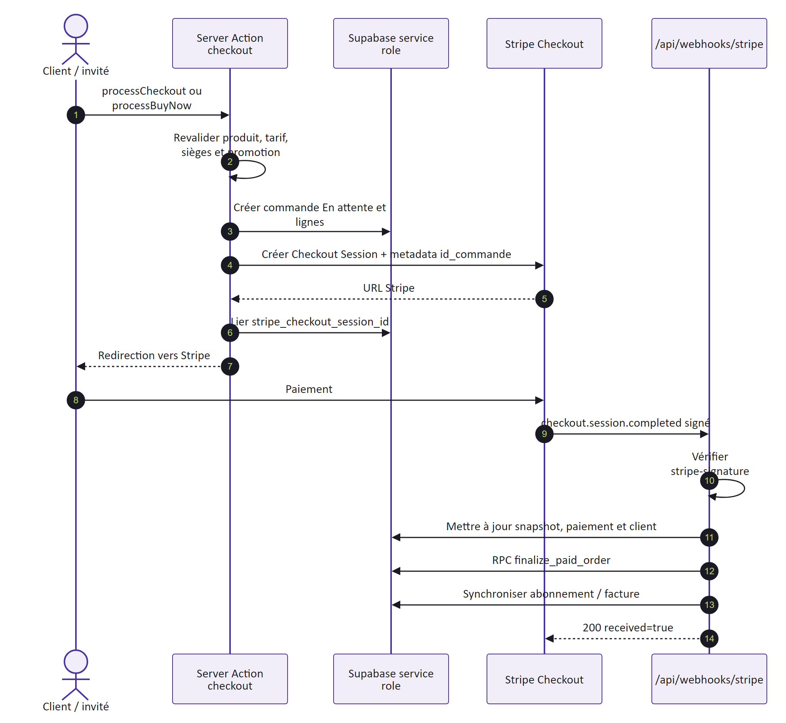

## Abonnements, échéanciers et factures

`customer.subscription.updated/deleted` synchronise `abonnement`. Les événements `subscription_schedule.*` résolvent l'abonnement Stripe puis réutilisent la même synchronisation. Les événements `invoice.finalized`, `invoice.paid`, `invoice.payment_failed` et `invoice.voided` effectuent un upsert par `stripe_invoice_id`. Le PDF Stripe est téléchargé une fois dans `invoice-pdf`; le chemin et l'URL hébergée sont enregistrés. Un code 500 demande à Stripe de rejouer l'événement. Les écritures utilisent des identifiants externes uniques ou des RPC réentrantes pour supporter ce replay.

## Décisions et compromis financiers

| Décision | Justification | Conséquence |
|---|---|---|
| Stripe source de vérité | Évite de conclure sur un simple retour navigateur | Nécessite webhook disponible et supervision |
| Commande avant session | Corrélation stable et reprise possible | Les commandes abandonnées doivent être suivies |
| Montants serveur | Empêche la manipulation client | Relecture catalogue obligatoire au checkout |
| Facture en bucket privé | Résilience et espace client | Politique Storage et URL signée à maintenir |
| Portail Stripe configuré | Délègue les mutations d'abonnement sûres | Configuration externe à versionner par procédure |

# BackOffice, reporting et opérations sensibles

Le BackOffice est un ensemble de routes localisées sous `/[locale]/admin`. Le proxy bloque la navigation sans session, sans profil `admin` actif ou sans AAL2. Les actions et routes sensibles ne s'appuient pas sur ce seul contrôle périphérique : le rapport commerce, la réinitialisation MFA et les accès aux conversations répètent la garde adaptée avant de créer un client privilégié ou de retourner des données.

Les écrans administrent le catalogue, les promotions, les commandes, les abonnements, les utilisateurs, le support, l'historique CynAI, le carrousel et les textes d'accueil. Les opérations de masse conservent les mêmes validations que les opérations unitaires. Les suppressions sont limitées lorsqu'une relation historique rend la donnée nécessaire à une commande, un audit ou une facture.

## Génération du rapport commerce

`GET /api/admin/sales/report` commence par lire l'utilisateur de session, son profil actif et l'assurance AAL2. Les paramètres `preset`, `from`, `to`, `horizon` et `locale` sont normalisés avant toute agrégation. Le service collecte commandes, lignes, produits, catégories et santé des abonnements, puis applique les fonctions pures d'agrégation et de localisation. `@react-pdf/renderer` transforme ensuite `CommerceReportPdf` en buffer.

| Phase | Contrôle | Résultat |
|---|---|---|
| Authentification | utilisateur Supabase présent | sinon `401 UNAUTHENTICATED` |
| Autorisation | profil admin actif | sinon `403 FORBIDDEN` |
| Assurance | `currentLevel = aal2` | sinon `403 AAL2_REQUIRED` |
| Période | preset connu ou dates custom cohérentes | sinon `400 INVALID_RANGE` |
| Agrégation | requêtes Supabase et fonctions de domaine | données chiffrées et libellés localisés |
| Rendu | `renderToBuffer` | PDF privé `no-store` en pièce jointe |

Le PDF est renvoyé avec `Content-Type: application/pdf`, `Content-Disposition: attachment` et `Cache-Control: private, no-store`. Une erreur de saisie de période n'est pas un incident. Une autre exception est capturée avec `area=commerce-report` et `stage=render-pdf`, sans joindre les données commerciales au diagnostic. Le rapport n'est donc ni un endpoint public ni une preuve comptable indépendante de Stripe.

## Réinitialisation MFA et audit

La récupération MFA d'un autre administrateur exige un ticket d'accès, une cible autorisée et l'intervention d'un second administrateur. Les facteurs sont supprimés via l'API d'administration seulement après validation, puis l'action est inscrite dans `mfa_reset_audit` avec acteur, cible, ticket, motif et horodatage. Cette table est une piste d'audit métier ; Sentry ne la remplace pas et ne doit pas recevoir son contenu détaillé.

# Architecture détaillée de CynAI

## Contrat et boucle de génération

`POST /api/chat` accepte `messages`, `locale` et un `conversationId` facultatif. Après validation minimale, la route résout l'utilisateur, crée ou relit le cookie invité, vérifie la propriété de la conversation et persiste le dernier tour utilisateur. Elle ouvre ensuite un `ReadableStream` NDJSON et émet l'identifiant canonique.

Gemini `gemini-3.1-flash-lite` reçoit l'instruction système, les tours visibles et quatre déclarations de fonction. Chaque round utilise `generateContentStream`. Les `Part` retournées sont conservées telles quelles, y compris les `thoughtSignature`; les fragments de texte non `thought` sont diffusés. Si des `functionCall` existent, les outils sont exécutés, leurs cartes sont émises et leurs `functionResponse` réinjectées. La boucle est bornée à quatre rounds. En l'absence d'appel d'outil, la réponse est finale.

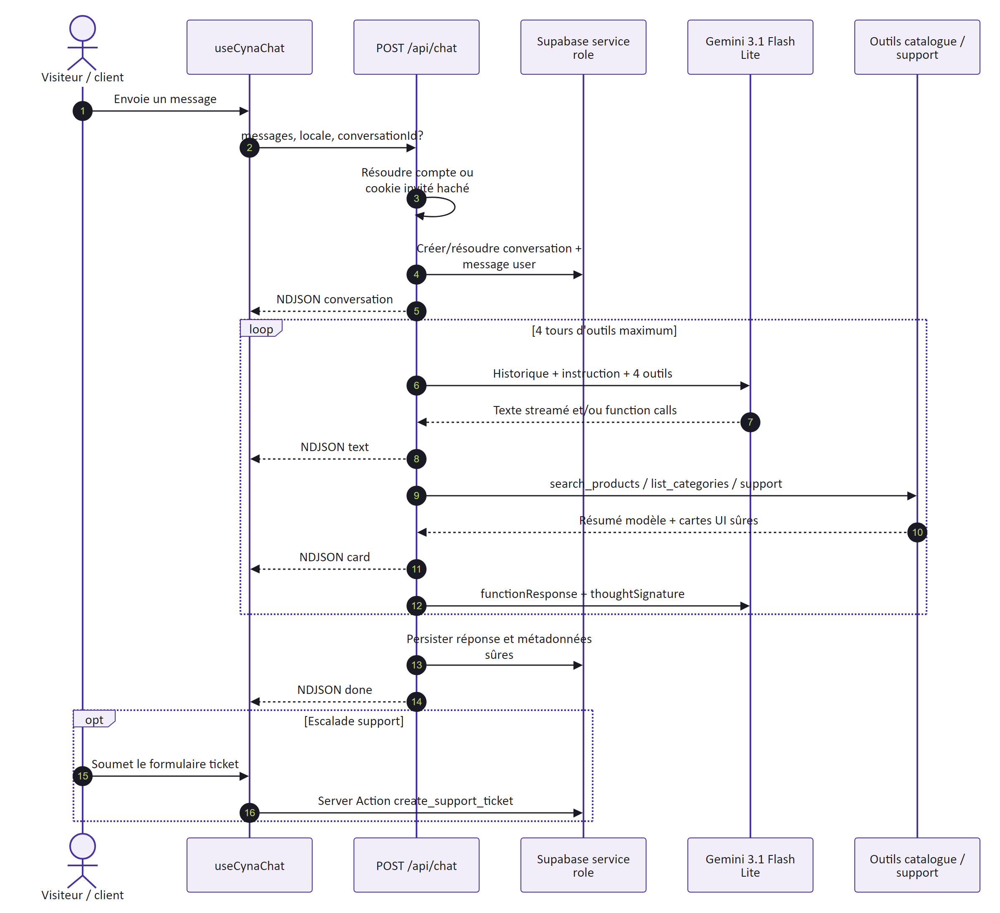

| Événement | Charge utile | Rôle client |
|---|---|---|
| `conversation` | `id` UUID | Conserver l'identifiant pour le prochain tour |
| `text` | fragment `value` | Ajouter le texte progressivement |
| `card` | union `product`, `category`, `support`, `login` ou `ticketForm` | Rendre une carte interactive typée |
| `done` | aucune | Clore proprement le tour |
| `error` | message générique | Signaler l'échec sans exposer l'exception |

## Outils et minimisation

`search_products` réutilise la recherche publique et transmet trois produits maximum. `list_categories` transmet trois catégories maximum et le total. `show_support_page` renvoie une carte de navigation. `open_support_form` récupère uniquement les commandes du compte connecté et préremplit son e-mail. Gemini reçoit une projection compacte, tandis que le navigateur reçoit une carte structurée ; aucun outil ne lui remet un enregistrement de profil complet, une clé ou une requête générique.

## Propriété, rétention et audit

Le cookie `cyna_chat_guest` est HTTP-only, SameSite Lax, Secure en production et expire avec la rétention de 90 jours. La base ne reçoit que `SHA-256(cookie)`. Une conversation a soit `id_compte`, soit `guest_session_hash`. La reprise vérifie cette propriété avant insertion. Les messages conservent rôle, contenu, statut et métadonnées sûres. La purge est implémentée par RPC mais son ordonnancement reste une responsabilité d'exploitation.

Les erreurs de persistance et de génération sont capturées dans Sentry avec des tags `area` et `stage`, après suppression des utilisateurs, corps, cookies, autorisations et en-têtes privés. Le client n'envoie pas le contenu du cookie. Les limites suivies sont le rate limiting absent, les tailles peu bornées, la perte du `conversationId` au rechargement et la couverture API incomplète.

# Qualité logicielle et modes de défaillance

La suite Vitest couvre principalement les règles de domaine et les adaptateurs isolables : panier, promotions, états de commande et d'abonnement, plages de rapport, agrégations, outils CynAI, propriété/persistance du chat, filtrage Sentry et comportements Stripe. Elle contient 112 tests dans l'état documenté. La CI exige que ce nombre ne régresse pas implicitement, mais le volume de tests n'est pas assimilé à un taux de couverture exhaustif.

Le script `smoke:routes` vérifie que les routes client essentielles répondent sur une instance déployée. Les tests de preview complètent cette sonde par une validation humaine de la recherche, de l'authentification, du chatbot, du checkout Stripe test et du rapport admin. Les scénarios end-to-end multi-fournisseurs ne sont pas encore automatisés ; les routes chat et webhook restent moins couvertes que la logique métier qu'elles orchestrent.

| Défaillance | Comportement attendu | Signal | Reprise |
|---|---|---|---|
| Supabase inaccessible avant chat | réponse 503 avant ouverture du stream | Sentry `area=chat` et état fournisseur | rétablir persistance puis retester propriété |
| Gemini en erreur après ouverture | événement NDJSON `error`, pas de stack | capture filtrée, quota fournisseur | nouveau tour contrôlé après correction |
| Signature Stripe invalide | 400, aucune mutation | métrique/log webhook sans corps sensible | corriger secret ou endpoint, ne pas rejouer comme valide |
| Traitement Stripe valide en erreur | 500 pour obtenir un retry | Dashboard Stripe et Sentry filtré | corriger puis laisser/rejouer l'événement |
| Rapport impossible | JSON 500, aucun PDF partiel mis en cache | `area=commerce-report` | corriger agrégation/rendu puis régénérer |
| Build ou source maps en échec | CI/Netlify rouge, pas de release | checks GitHub et logs Netlify | corriger sur branche, nouvelle preview |

La stratégie de tests suit les frontières de risque : fonctions pures rapides à chaque commit, build complet en CI, puis essais avec fournisseurs sur preview. Une correction de sécurité ou de paiement doit ajouter un test de non-régression au niveau le plus proche de la cause, et un smoke test lorsque l'intégration externe est déterminante.

# Intégration continue et observabilité

La CI GitHub Actions unique s'exécute sur les pushes et PR vers `dev` et `prod`. Le job stable `CI / quality` utilise Node 24, `npm ci` avec cache, le lint, au moins 112 tests Vitest, `npm audit --omit=dev --audit-level=high` et le build avec variables factices non secrètes. Les permissions se limitent à la lecture du contenu et une nouvelle exécution annule l'ancienne pour la même branche.

Dependabot vérifie npm dans `/webapp-cyna` chaque semaine vers `dev`, regroupe les patchs et minors et conserve les majors séparées ; les actions GitHub sont également surveillées. Le graphe de dépendances, les alertes et mises à jour de sécurité restent à activer dans l'interface GitHub.

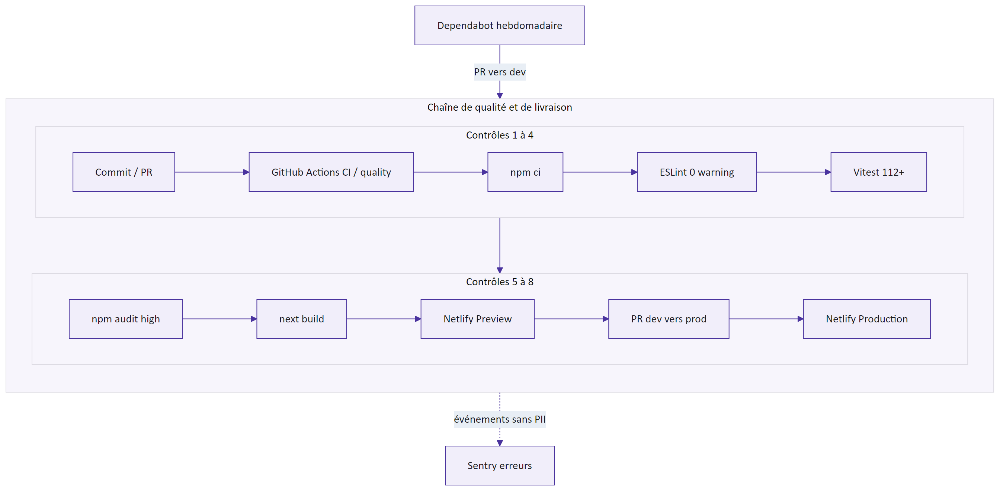

Sentry initialise les runtimes client, server et edge et branche `onRequestError` ainsi que `global-error.tsx`. `withSentryConfig` compose la configuration `next-intl`. Sans `NEXT_PUBLIC_SENTRY_DSN`, l'application reste fonctionnelle et le SDK est désactivé. La configuration cible exclusivement les erreurs : `tracesSampleRate = 0`, aucun replay, log ou PII par défaut. `SENTRY_AUTH_TOKEN`, `SENTRY_ORG` et `SENTRY_PROJECT` servent au build de production pour les source maps.

<!-- landscape-start -->

# Modèle conceptuel de données

Le MCD expose les concepts et cardinalités métier, sans recopier mécaniquement chaque clé étrangère. L'identité `auth.users` est externe. Un utilisateur métier peut avoir des adresses, commandes, abonnements, factures, tickets et conversations. Une commande comprend des lignes qui figent les informations nécessaires au commerce. Les traductions et liaisons promotionnelles appartiennent aux vues physiques spécialisées.

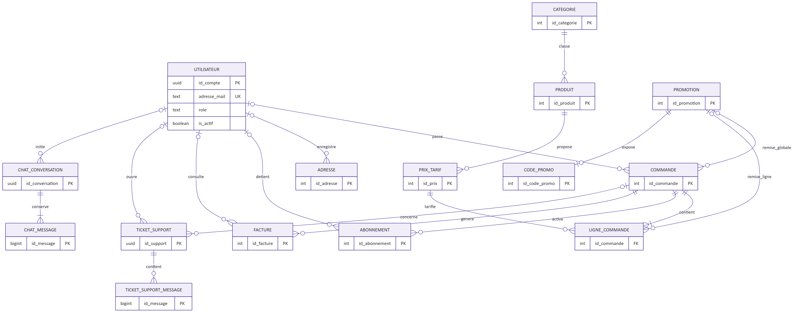

<!-- page-break -->

## Vue catalogue

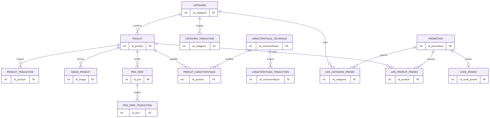

Les entités stables `produit`, `categorie`, `prix_tarif` et `caracteristique_technique` portent les identifiants et attributs non traduits. Les tables `*_traduction` portent les libellés par locale. `produit_caracteristique_technique` matérialise le N:N produit-caractéristique ; `lien_produit_promo` et `lien_categorie_promo` matérialisent les cibles promotionnelles.

<!-- page-break -->

## Vue commerce

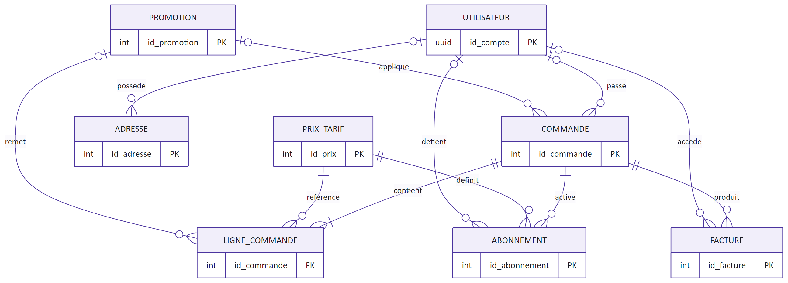

La nullabilité de `commande.id_compte` et des adresses permet le checkout invité. `ligne_commande` rattache chaque achat à une commande et au produit de référence tout en conservant les valeurs utiles au calcul. `abonnement` et `facture` portent les identifiants Stripe nécessaires à la réconciliation.

<!-- page-break -->

## Vue support et chatbot

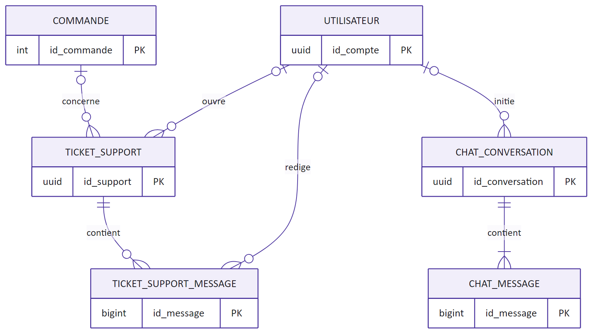

Un ticket peut appartenir à un client ou à un invité et référencer une commande facultative. Les messages forment l'historique. Une conversation chat peut appartenir au compte ou à une session invitée hashée ; ses messages sont supprimés avec la conversation selon les règles de rétention.

## Vue CMS, i18n et audit

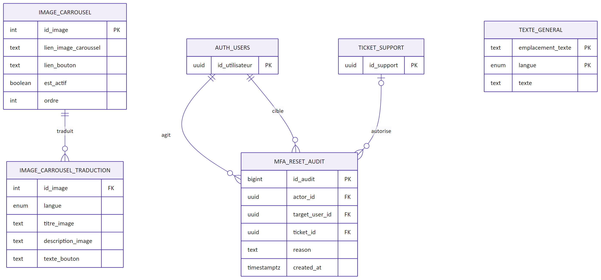

<!-- page-break -->

# Dictionnaire physique des 28 tables

| Table | Clé primaire | Finalité | Relations ou contraintes clés | Sensibilité |
|---|---|---|---|---|
| `utilisateur` | `id_compte` UUID | Profil métier lié à Auth, rôle, activité, client Stripe | 1:1 avec `auth.users`; parent de données client | Élevée |
| `adresse` | `id_adresse` | Adresse client ou invité, défaut et suppression logique | `id_compte` nullable ; e-mail invité possible | Élevée |
| `categorie` | `id_categorie` | Taxonomie stable du catalogue | Parent produits, traductions et promotions | Publique |
| `categorie_traduction` | clé composée | Nom et contenu localisés d'une catégorie | catégorie + locale uniques | Publique |
| `produit` | `id_produit` | Offre SaaS stable, disponibilité et métadonnées | catégorie, traductions, prix, images, lignes | Publique |
| `produit_traduction` | clé composée | Nom et description localisés | produit + locale uniques | Publique |
| `prix_tarif` | `id_prix_tarif` | Tarif, facturation et référence Stripe | appartient à un produit | Interne |
| `prix_tarif_traduction` | clé composée | Libellé localisé du tarif | prix + locale | Publique |
| `caracteristique_technique` | `id_caracteristique` | Définition d'une caractéristique | traductions et liaison N:N | Publique |
| `caracteristique_technique_traduction` | clé composée | Libellé localisé de caractéristique | caractéristique + locale | Publique |
| `produit_caracteristique_technique` | clé composée | Valeur d'une caractéristique pour un produit | N:N produit-caractéristique | Publique |
| `image_produit` | `id_image_produit` | Visuel et ordre d'affichage produit | appartient à un produit | Publique |
| `promotion` | `id_promotion` | Remise, dates, type, activité | cibles produit/catégorie ; codes possibles | Interne |
| `code_promo` | `id_code_promo` | Code saisi et contraintes d'utilisation | lié à une promotion | Interne |
| `lien_produit_promo` | clé composée | Ciblage promotion-produit | table de liaison N:N | Interne |
| `lien_categorie_promo` | clé composée | Ciblage promotion-catégorie | table de liaison N:N | Interne |
| `commande` | `id_commande` | En-tête d'achat, total et snapshots Stripe | compte nullable, lignes, abonnements, factures | Élevée |
| `ligne_commande` | `id_ligne_commande` | Produit, quantité, prix et remise d'une commande | appartient à commande et produit | Élevée |
| `abonnement` | `id_abonnement` | Projection locale d'un abonnement Stripe | compte, commande, produit, identifiant Stripe | Élevée |
| `facture` | `id_facture` | Métadonnées et stockage d'une facture Stripe | compte/commande nullable, invoice ID unique | Élevée |
| `ticket_support` | `id_ticket` | Demande client/invité, priorité et statut | compte et commande facultatifs | Élevée |
| `ticket_support_message` | `id_message` | Échanges d'un ticket | ticket parent, auteur et rôle | Élevée |
| `chat_conversation` | `id_conversation` UUID | Propriété, locale et rétention CynAI | compte ou hash invité ; messages enfants | Élevée |
| `chat_message` | `id_message` UUID | Tour utilisateur/assistant et métadonnées sûres | appartient à une conversation | Élevée |
| `texte_general` | `id_texte_general` | Blocs éditoriaux localisés | clé fonctionnelle et locale | Publique |
| `image_carrousel` | `id_image_carrousel` | Visuel de carrousel, ordre et activité | traductions enfants | Publique |
| `image_carrousel_traduction` | clé composée | Titre, alternative et lien localisés | image + locale | Publique |
| `mfa_reset_audit` | `id_audit` | Traçabilité des actions de réinitialisation MFA | acteur, cible, date et résultat | Très élevée |

## Lecture opérationnelle du dictionnaire

Le dictionnaire distingue trois responsabilités. Supabase Auth reste l'autorité des identités et des facteurs MFA ; `utilisateur` en est la projection métier, enrichie du rôle, de l'état d'activation et de l'identifiant client Stripe. Stripe demeure l'autorité financière ; `commande`, `abonnement` et `facture` en conservent les références, snapshots et états nécessaires au service client et à la réconciliation. Enfin, PostgreSQL fait autorité pour le catalogue, le support, les conversations et les contenus éditoriaux.

| Domaine | Écriture autorisée | Cohérence attendue | Contrôle d'exploitation |
|---|---|---|---|
| Identité et MFA | Auth Supabase et procédures administratives gardées | projection `utilisateur` liée à `auth.users` | comptes inactifs, AAL2 et piste `mfa_reset_audit` |
| Catalogue et CMS | Server Actions BackOffice après RBAC | entités stables séparées des traductions | doublons de locale, médias orphelins et ordre d'affichage |
| Commandes et facturation | checkout serveur puis webhooks Stripe signés | convergence par identifiants externes uniques et RPC réentrantes | commandes en attente, abonnements divergents et factures manquantes |
| Support et CynAI | compte propriétaire ou session invitée hashée | messages enfants rattachés à leur ticket ou conversation | accès BackOffice, purge à 90 jours et métadonnées minimisées |

Les colonnes nullable ne sont pas interprétées comme des relations absentes par défaut : elles modélisent notamment le checkout invité, les tickets non associés à une commande et les factures rattachables selon le contexte. Toute évolution doit donc partir de la migration SQL, mettre à jour les types générés et les politiques RLS, puis réconcilier ce dictionnaire et les vues Mermaid dans le même changement.

<!-- landscape-end -->

# Décisions techniques et dette suivie

| Décision | État | Motif | Réévaluation |
|---|---|---|---|
| Next.js App Router et Server Actions | Adoptée | Cohérence SSR, mutations proches de l'UI | Sur évolution des contrats Next.js |
| Supabase managé | Adoptée | Auth, PostgreSQL, RLS et Storage intégrés | Tester régulièrement sauvegarde/restauration |
| Netlify OpenNext natif | Adoptée | Preview PR et support Next.js sans plugin épinglé | À chaque montée majeure Next.js |
| Sentry erreurs seules | Adoptée | Visibilité avec minimisation des données | Ajouter performance seulement sur besoin mesuré |
| Gemini avec outils fermés | Adoptée | Réponses ancrées dans le catalogue | Renforcer quotas, tailles et tests d'injection |
| CI Node 24 | Adoptée | Runtime déterministe et support actuel | Réviser avant fin de support Node 24 |

La dette prioritaire porte sur les tests E2E et API, le rate limiting du chatbot, la validation de taille, l'ordonnancement de purge, la preuve de restauration, le suivi des commandes abandonnées et l'automatisation de vérifications Stripe. Aucun de ces points ne justifie une migration de schéma dans le présent chantier.
